# Automação de Solicitações de Viagens Corporativas - Power Automate Desktop

Robô desenvolvido no **Power Automate Desktop** que processa uma fila de solicitações de viagem em Excel: valida os dados, faz a reserva no portal escolhendo o voo de menor preço, captura o código da reserva (PNR) e devolve o resultado para a planilha, enviando um relatório por e-mail no final.

## Demonstração

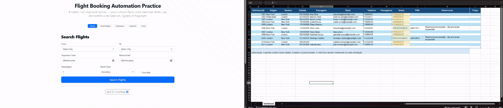

## O que o robô faz

1. **Lê a planilha** de solicitações e percorre linha a linha.
2. **Valida os dados**: campos obrigatórios vazios, origem igual ao destino e e-mail inválido.
3. **Reserva no portal**: pesquisa One Way, escolhe o voo de menor preço e preenche passageiro e pagamento.
4. **Captura o PNR** e o preço pago na tela de confirmação.
5. **Registra e envia**: grava Status, PNR, Observação e Preço no Excel, fecha os recursos e envia o relatório por e-mail.

## Arquitetura

O `Main` só orquestra. Cada subfluxo tem uma única responsabilidade.

| Subfluxo | Responsabilidade |
|---|---|
| `Main` | Chama os subfluxos na ordem de execução |
| `Inicializar` | Configurações centralizadas, abre Edge e Excel, lê a planilha e grava o cabeçalho do log |
| `ValidarSolicitacao` | Percorre a fila, filtra `PENDENTE` e aplica as regras de validação |
| `RealizarReserva` | Pesquisa, seleciona o menor preço, preenche passageiro e pagamento e captura o PNR |
| `AtualizarExcel` | Grava as colunas I a L, soma os contadores e grava a linha no log |
| `Finalizar` | Salva e fecha o Excel, fecha o navegador e grava o rodapé do log |
| `Email` | Envia o relatório HTML pelo Outlook com a planilha anexada |

O código de cada subfluxo está na pasta [`fluxos/`](fluxos) e na seção [Fluxos](#fluxos).

## Regras de negócio

| Cenário | Status gravado |
|---|---|
| Status diferente de `PENDENTE` | Linha ignorada (mantém o atual) |
| Campo obrigatório vazio | `ERRO_VALIDACAO` |
| Origem igual ao destino | `ERRO_VALIDACAO` |
| E-mail inválido (regex `^[^@\s]+@[^@\s]+\.[^@\s]+$`) | `ERRO_VALIDACAO` |
| Reserva concluída | `PROCESSADO` |
| Falha técnica no portal | `ERRO_SISTEMA` (o robô volta ao portal e segue a fila) |

Toda a validação acontece antes de qualquer ação no site. A reserva roda dentro de um bloco de tratamento de erro, então uma falha no portal não interrompe a fila.

## Destaques

- **Voo de menor preço**: o robô lê todos os preços, compara e clica no botão *Select* do mais barato com um seletor dinâmico (`button[Text="Select"]:eq(${IndiceMenor})`).
- **Captura do preço pago**, gravado na planilha e somado no relatório.
- **Relatório por e-mail em HTML** com indicadores, tempo economizado e planilha anexada.
- **Log em TXT** com uma linha por solicitação.
- **Teste de falha técnica**: uma solicitação com cidade inexistente comprova que o erro vira `ERRO_SISTEMA` sem parar a fila.

## Fluxos

### Main
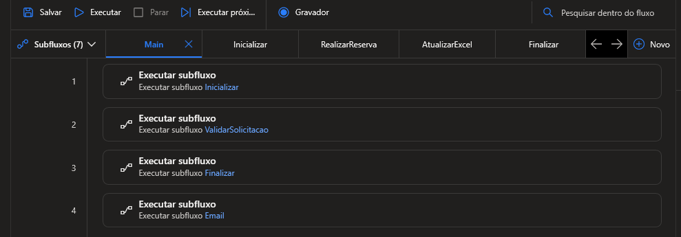

### Inicializar
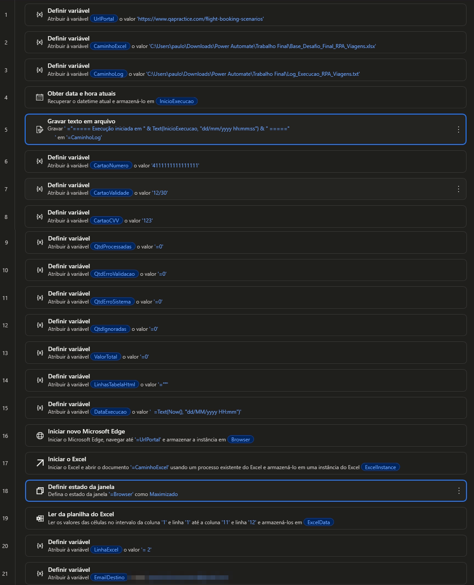

### ValidarSolicitacao
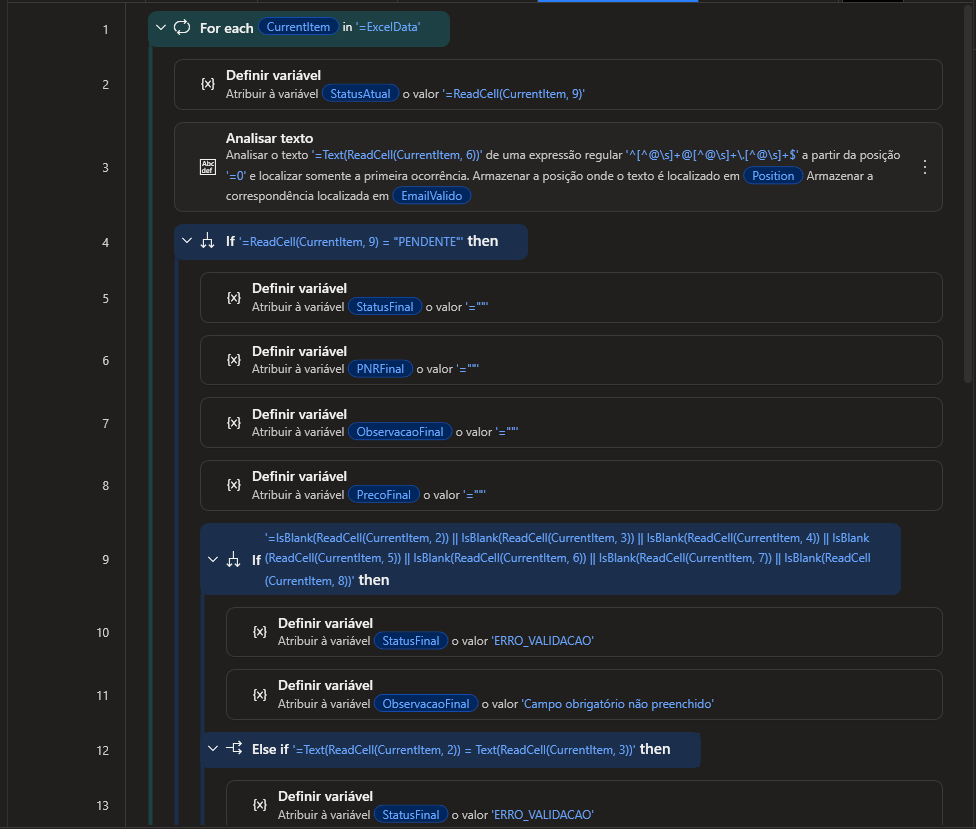
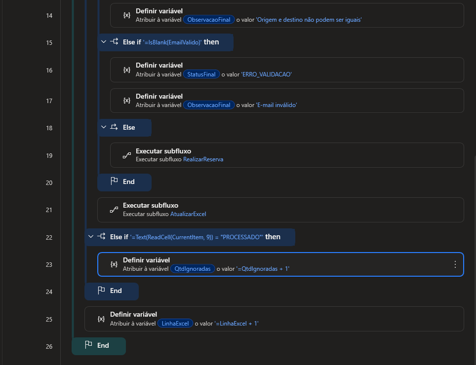

### RealizarReserva
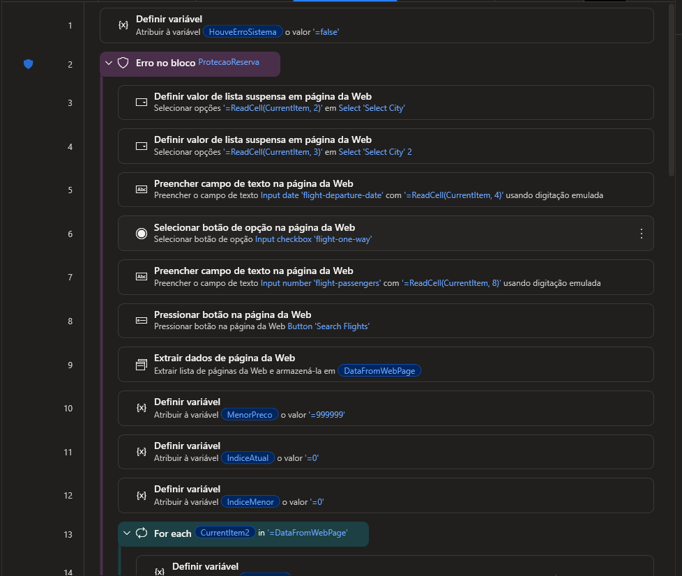
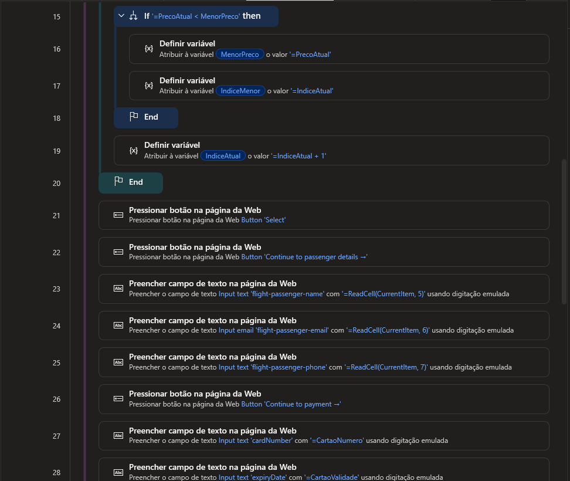
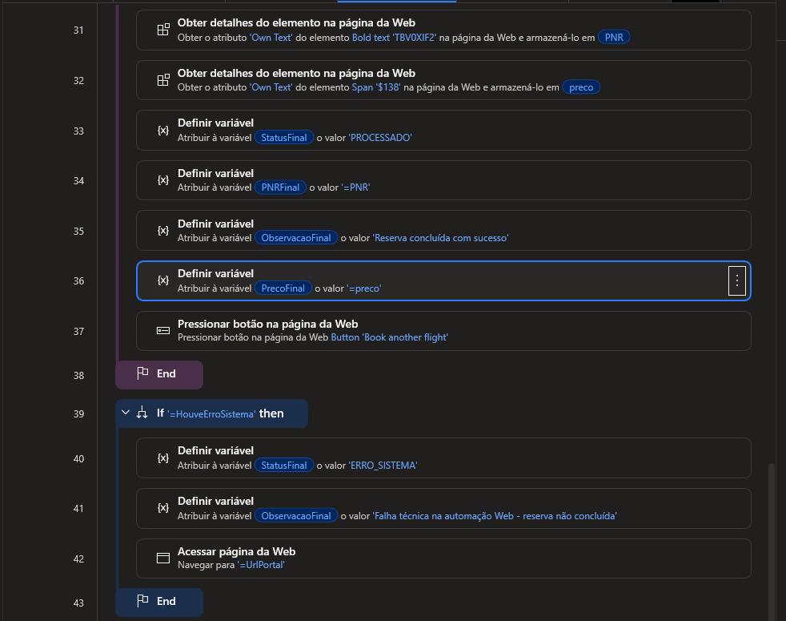

### AtualizarExcel
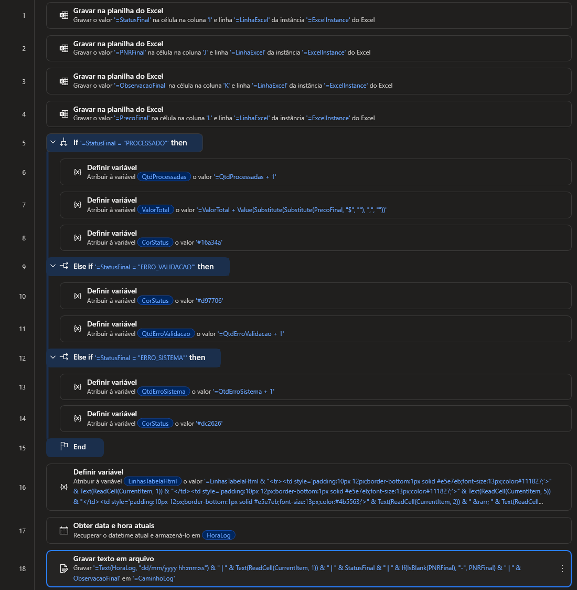

### Finalizar
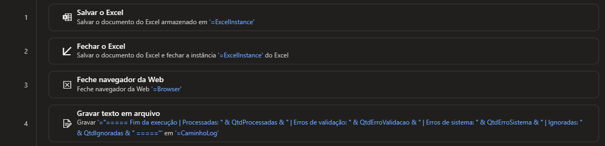

### Email
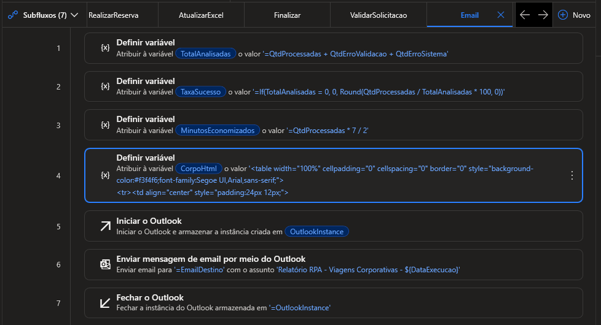

## Resultado

### Planilha após a execução
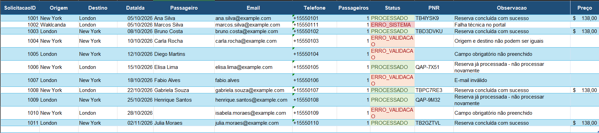

### Relatório enviado por e-mail
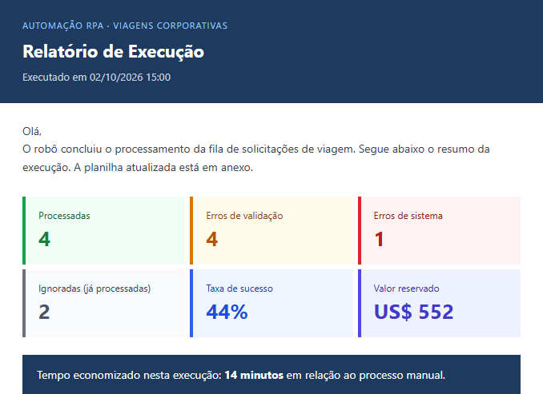
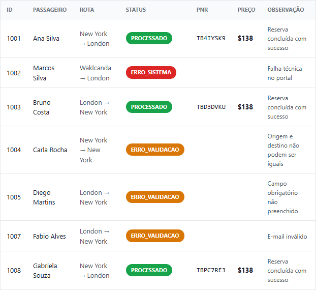

### Log de execução
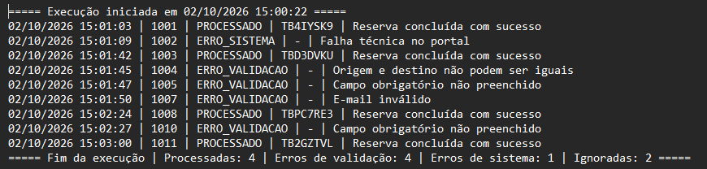

## Ganho estimado

| Indicador | Resultado |
|---|---|
| Tempo manual por solicitação | 4 min |
| Tempo com o robô | 30 s |
| Horas economizadas por mês (450 solicitações) | 26,25 h |
| Ganho líquido mensal | R$ 950,00 |
| Payback | ≈ 2,5 meses |

## Tecnologias

- Power Automate Desktop
- Microsoft Edge (automação web)
- Microsoft Excel
- Microsoft Outlook
- Portal de testes [QA Practice](https://www.qapractice.com/flight-booking-scenarios)

## Autor

Paulo Victor Martins Carneiro
